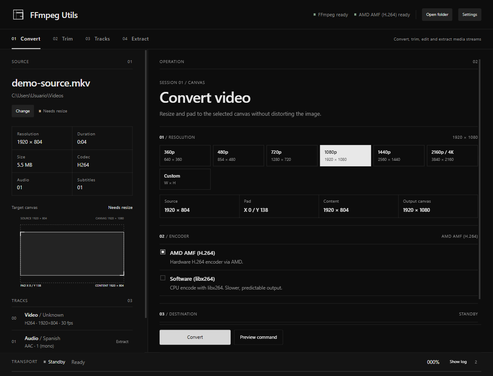
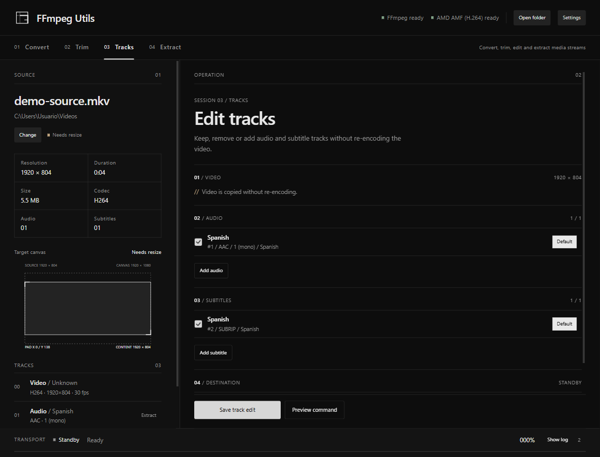

# FFmpeg Utils

A modern Windows desktop app to **convert**, **trim**, **edit tracks** and
**extract** media streams with FFmpeg and hardware acceleration. Built with
**Tauri 2 + Rust + React**.

The interface is available in **English (default)** and **Spanish**, with a
compact workbench and comfortable/compact density. Built with HeroUI v3 and a
small set of custom SVG marks.





## Features

- Drag and drop a video file, or pick one with the native dialog.
- Automatic FFprobe analysis: resolution, duration, codecs, FPS, audio and
  subtitle tracks, languages, channels, titles, default/forced flags, chapters
  and attachments.
- **Convert video**: 360p, 480p, 720p, 1080p, 1440p, 2160p/4K or custom even
  dimensions, with aspect-preserving scale and padding.
- **Trim**: fast stream copy or precise re-encode with AMD AMF or software.
- **Edit tracks**: keep or remove audio/subtitles, add external tracks or tracks
  from another video, and set language, title, default and forced flags.
- **Extract** audio and subtitles without re-encoding, or convert audio to
  MP3/M4A/FLAC/WAV/AC3/Opus and text subtitles to SRT/WebVTT.
- **Single-audio copy**: keep only English or Spanish audio.
- Hardware encoder detection with real test encodes: AMD AMF, NVIDIA NVENC
  and Intel Quick Sync, plus software libx264 fallback.
- Live progress, FFmpeg log, command preview, safe cancellation and FFprobe
  verification.
- English/Spanish i18n and comfortable/compact density.
- Settings and window size are remembered in `%APPDATA%\FFmpegUtils\`.

## Requirements

- Windows 10 or 11.
- [WebView2 runtime](https://developer.microsoft.com/microsoft-edge/webview2/)
  (usually installed on Windows 11).
- FFmpeg and FFprobe in `PATH`, in a common folder, or selected in Settings.
- Optional hardware encoding via AMD AMF, NVIDIA NVENC or Intel Quick Sync.
  Software libx264 encoding works without dedicated hardware.

## Install

Download the latest `FFmpeg Utils_*_x64-setup.exe` from Releases and run it.
FFmpeg is **not** bundled; install it separately.

## Build from source

Quick start on Windows:

`at
install.bat
run.bat
`

Or manually. Prerequisites:

- Rust stable with the MSVC target.
- Visual Studio Build Tools with the C++ workload (or Visual Studio Community).
- Node.js 20+ and npm.

```powershell
npm install
npm run tauri dev
```

Release build and installer:

```powershell
npm run tauri build
```

The NSIS installer is written to
`src-tauri/target/release/bundle/nsis/`.

## Usage

### Convert

1. Drop a video.
2. Choose **Convert**.
3. Pick a resolution: 360p, 480p, 720p, 1080p, 1440p, 2160p or custom.
4. Pick an available encoder (AMD AMF, NVIDIA NVENC, Intel Quick Sync or
   software libx264). **Keep video** is only offered when no resize is needed.
5. Press **Convert**.

Output: `Movie_720p.mkv`, `Movie_1080p.mkv` or `Movie_1600x900.mkv`.

### Trim

1. Open **Trim**.
2. Set start and end with the fields or the range slider.
3. Choose **Fast** (stream copy) or **Precise** (AMF or software).
4. Press **Trim**.

Fast mode is instant but starts at the previous keyframe. Precise mode decodes
from the beginning to keep exact timestamps, so it is slower on long files.
Chapters are dropped because their timestamps refer to the original timeline.

Output: `Movie_1080p_trim_00-01-23-00-02-45.mkv`.

### Edit tracks

1. Open **Tracks**.
2. Uncheck any audio or subtitle you want to remove.
3. Use **Add audio** or **Add subtitle** to import a file or a track from another
   video.
4. Set the default audio, default subtitle, language, title and forced flag as
   needed.
5. Press **Save track edit**.

Video is copied without re-encoding, and chapters/attachments are preserved.
Output: `Movie_tracks.mkv`.

### Extract

- Open **Extract** and use **Extract tracks…**, **All audio** or **All
  subtitles**, or click the extract icon on any audio/subtitle row.
- Select tracks, the output format for each track, output folder and collision
  policy.
- Each track is written to its own file:

```
Movie.audio.2.eng.eac3
Movie.subtitle.5.eng.ass
Movie.audio.1.spa.mp3
Movie.subtitle.3.spa.vtt
```

**Original** copies the stream without re-encoding. Audio can be converted to
MP3, M4A/AAC, FLAC, WAV, AC3 or Opus. Text subtitles can be converted to SRT or
WebVTT. Bitmap subtitles (PGS/DVD) stay in their original format.

### Single audio

After a conversion or trim, choose **Single English** or **Single Spanish**.
You can also use the single-audio section in **Extract**.

Output: `Movie_1080p_single_english.mkv`.

## Hardware encoders

```powershell
ffmpeg -hide_banner -encoders | findstr /i "amf nvenc qsv libx264"
```

The app tests each hardware encoder with a tiny encode at startup and only
offers the ones that actually initialise on the current machine. If none is
available it falls back to software libx264.

## Tests

```powershell
npm run typecheck
npm test
cargo test --manifest-path src-tauri/Cargo.toml
cargo clippy --manifest-path src-tauri/Cargo.toml --all-targets
```

Rust tests cover resolution, track selection, naming, trimming, extraction,
probe parsing and command generation. Frontend tests cover time/size helpers
and translation-catalog parity.

## Configuration and logs

- Config: `%APPDATA%\FFmpegUtils\config.json`
- Logs: `%APPDATA%\FFmpegUtils\logs`

## Notes and limitations

- One job at a time.
- No pause button; FFmpeg has no native pause and suspending it can corrupt the
  output.
- Fast trim snaps to keyframes; use precise mode for exact cuts.
- Language detection uses stream metadata, never filenames.
- Originals are never deleted or overwritten without confirmation.
- Unsigned installers may trigger SmartScreen.

## License

MIT © 2026 deyvvi. See [LICENSE](LICENSE).
